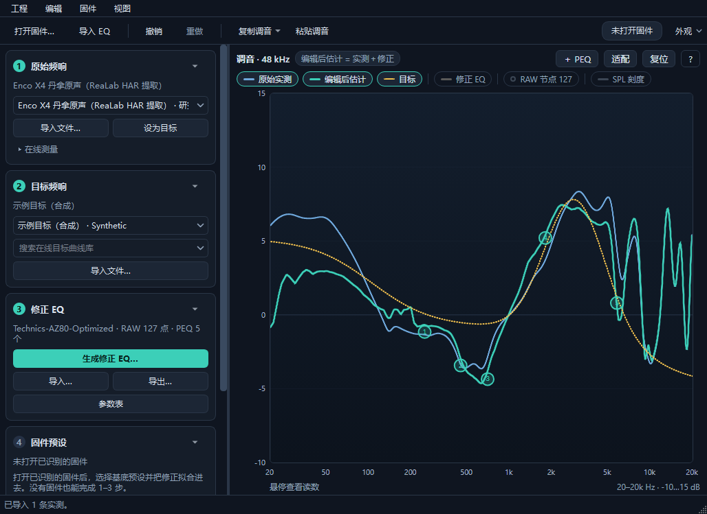
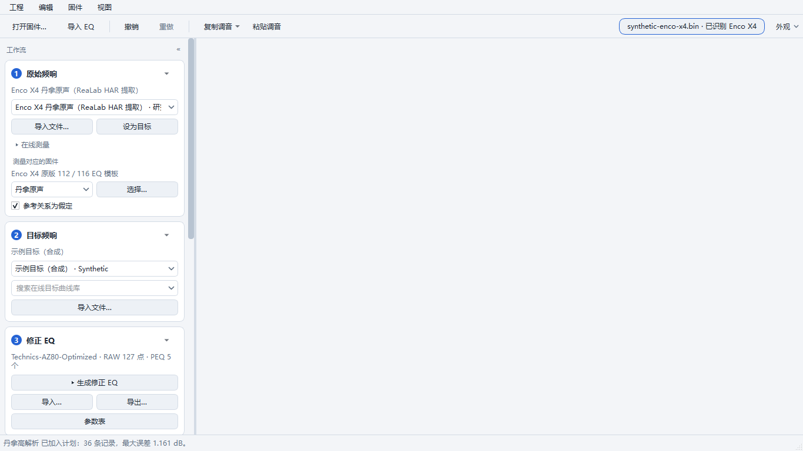
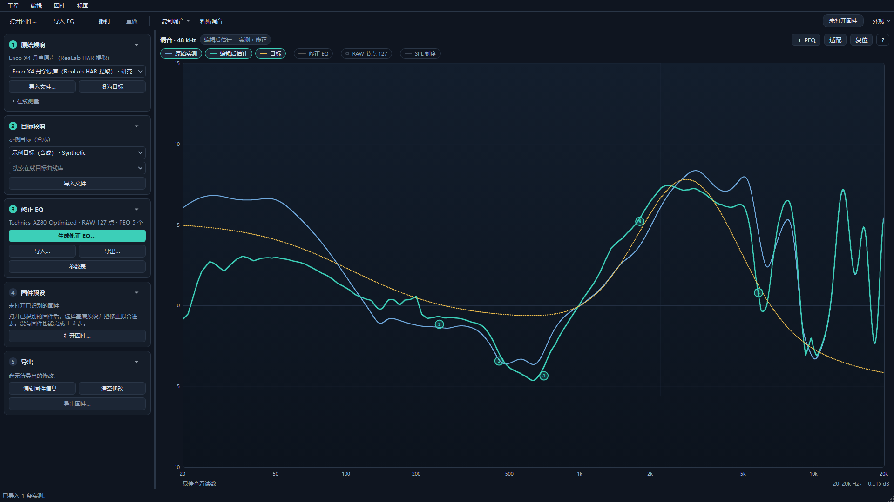
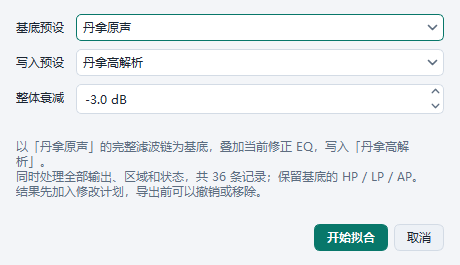
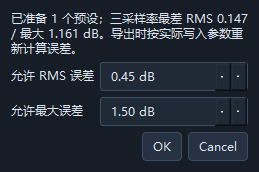
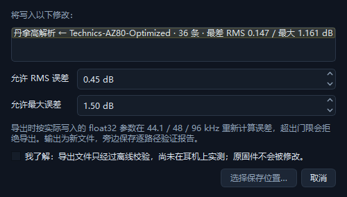
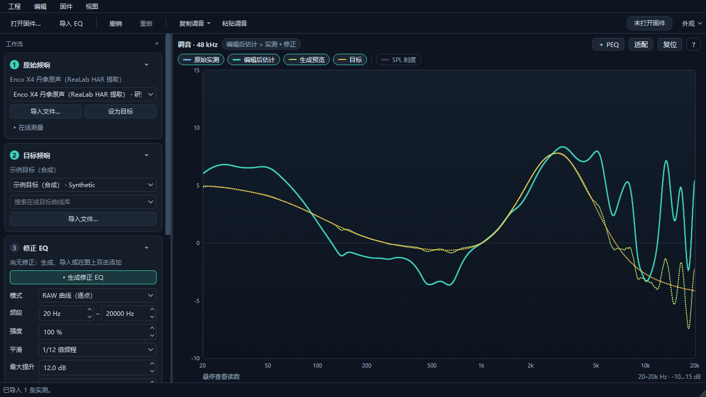
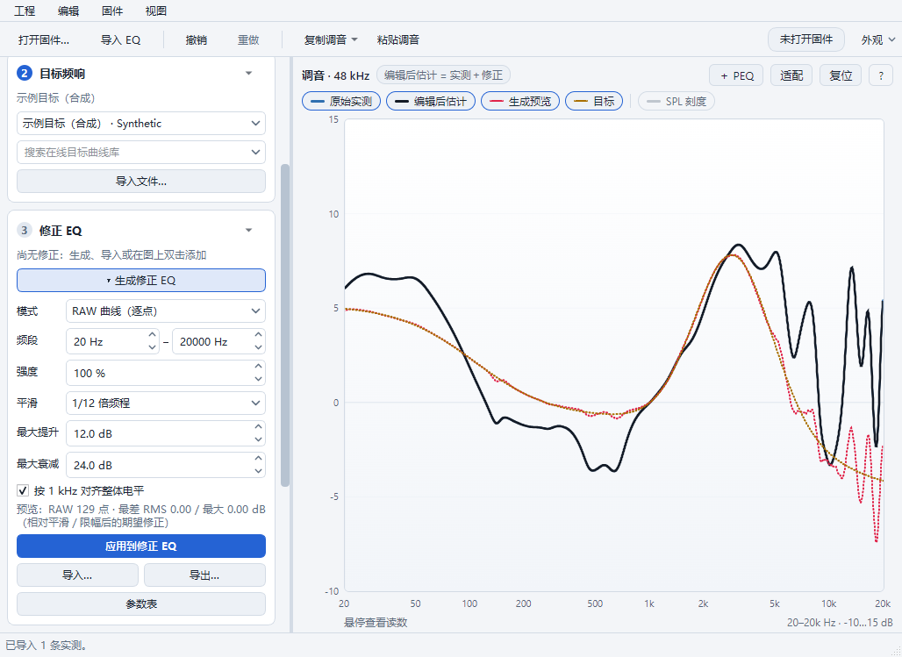

# 界面审查与重构记录（2026-10-11）

分支 `feat/claude-ux`，基线 `feat/python-desktop-studio` 的 `e73704c`（与交接文档的 `e62d5d1` 只差一个文档提交）。本记录对应提交 `8366b70` 起的 `feat/claude-ux` 系列提交。

## 截图方法

全部截图来自真实 Qt 窗口（`MainWindow.grab()`，含内嵌 WebEngine 图形），不是单独的浏览器页面。开发机屏幕为 1280×800 逻辑像素（200% 缩放），窗口无法达到 1366/1920 宽，所以截图时设置 `QT_SCALE_FACTOR=0.5`，等同 100% 缩放的显示器。数据：

- 原始测量：`research/archives/enco_x4_eq_toolkit.zip` 里由 ReaLab HAR 提取的 `fr_0.csv`（丹拿原声）；
- 目标：合成曲线（低频搁架 + 3 kHz 耳增益 + 高频滚降），仅用于演示，不是公开目标；
- EQ：`research/enco_x4_eq_toolkit/examples/Technics-AZ80-Optimized.txt`；
- 固件：测试用合成 Enco X4 夹具（`tests/firmware_fixture.py` 同结构），不含厂商数据。

## 重构前的问题

| 问题 | 证据 |
| --- | --- |
| 图形只占窗口高度的约三分之一：1028×749 与 1366×768 下图形只有 258 px 高 | 窗口内 `studioInspect()` 读数；见 baseline 截图 |
| 顶部选择区被限制为可滚动的窄条，第二行在线选择和“测量参考”行被截断；展开“计算详情”会把原始／目标卡片完全挤出视野 | `baseline-firmware-details-1366x768.png` |
| 两排曲线复选框、标签页、图内标题、页脚提示、质量说明、状态栏共占约 300 px | 同上 |
| 禁用的“拟合到固件预设／导出固件”与可用按钮外观完全相同（工具栏文字亮度都是 230） | 像素采样 |
| 目标曲线（#e3ad55）与 RAW 节点（#efb55a）几乎同色；127 个 RAW 节点盖住曲线 | `baseline-tuning-1028x749.png` |
| 纵轴固定 ±24 dB，常见数据只占一半高度 | 同上 |
| 对话框按钮为英文 OK／Cancel；拟合对话框不能选基底；导出对话框不列出写入内容，也没有风险确认；生成修正对话框在 RAW 模式也显示 PEQ 数量 | baseline 对话框截图 |
| 固件表显示类型编号（4／1／2／3） | `baseline-tuning-table-1366x768.png` |
| 每次刷新向图形发送 317 KiB–1.2 MB JSON；带 DAC 时刷新耗时 38.7 ms，超过 25 ms 的拖动预览间隔 | 同一夹具测量 |
| 只有深色主题，颜色写死在 Python 与 CSS 两处 | `plot.py`、`editor.css` |

## 重构后

| 窗口 | 重构前图形 | 重构后图形 |
| --- | --- | --- |
| 1028×749 | 914×258 | 904×538（侧栏自动收起为步骤条；展开时 614×538） |
| 1366×768 | 1252×258 | 952×557 |
| 1920×1080 | 1806×547 | 1506×869 |

| 刷新负载（同一夹具，10 次中位数） | 重构前 | 重构后 |
| --- | --- | --- |
| 空窗口 | 317 KiB · 8.6 ms | 1 KiB · 0.3 ms |
| 测量 + 目标 + AZ80 EQ | 710 KiB · 19.8 ms | 176 KiB · 7.2 ms |
| + 固件参考 | 866 KiB · 27.9 ms | 212 KiB · 9.8 ms |
| + DAC1／DAC2 | 1201 KiB · 38.7 ms | 286 KiB · 13.2 ms |

主要变化：

- 左侧工作流侧栏（原始频响 → 目标 → 修正 EQ → 固件预设 → 导出），每步一行状态；在线选择在载入测量后自动收起；固件相关控件只在识别固件后出现，特殊配置单独排列。
- 窗口窄于 1200 px 时侧栏收成 40 px 的步骤条（①–⑤，完成的步骤高亮），点击某一步展开并滚动到对应卡片；只在跨过阈值时自动切换，手动选择会保持（Ctrl+B）。
- 生成修正改为 ③ 内的设置面板：修改模式、频段、强度、平滑、最大提升／衰减或对齐后，后台重新拟合并以“生成预览”虚线显示，应用前不改变修正 EQ；“应用到修正 EQ”是一步可撤销的操作。预览按输入签名（测量、目标、设置、固件估计上下文）校验，过期结果直接丢弃。
- 图例即曲线开关（另有“视图 → 曲线”），只列出当前可用曲线；模型假设移到图形标题栏的提示标签；切换测量或目标时自动适配 dB 范围；手势说明收进“?”。
- 外观：跟随系统／浅色／深色 + 四种强调色，Qt 与图形共用一套颜色；Windows 切换配色时实时跟随。
- 参数表与固件信息改为停靠面板；状态栏只在有任务时显示进度和“取消”。
- 对话框中文化；拟合对话框同时选择基底与写入预设，默认写入另一个预设；导出前列出全部修改并要求确认“仅离线校验”。
- Python ↔ 图形消息升级为 schema 2，新增 `view`、`command` 事件，全部在 Python 侧校验。

| 重构前 | 重构后 |
| --- | --- |
|  |  |
|  |  |
|  |  |
|  |  |
|  |  |
|  |  |
|  |  |
|  |  |
|  |  |

## 验证

- 本地 Windows 11，Python 3.11.9 + `requirements-ci.txt` 锁定依赖：`pytest` 73 项通过（原 53 项 + 主题 12 项 + 外壳 8 项），`ruff check .` 通过。
- 前端：`npm test` 4 项（含新增纵轴适配），`npm run test:browser` 保留全部原有交互，并新增主题变量、图例开关、适配、Delete 键、空状态命令。
- `python -m heytap_eq.app --smoke-test` 通过。
- fork Actions：push 只跑检查；手动运行包含 PyInstaller／Nuitka 打包、冻结 EXE 启动与两种 EXE 对比。`3d35610`（重构后的外壳）与 `5a9df28`（侧栏折叠 + 内联生成修正）五个 job 全部通过。
- Windows runner 屏幕较小，窗口启动即低于 1200 px、侧栏为折叠状态；本地用 `QT_SCALE_FACTOR=1.1` 复现同一条件，外壳测试全部通过。

固件解析、DSP、拟合、写入与声学差分模型没有改动；工程 v4、撤销／重做、剪贴板格式保持兼容。

## PEQ 拟合提速

`fitting.fit_response` 的 PEQ 模式原来在每次目标函数调用里为每个滤波器、每个采样率分别构造并校验 `Filter`、调用一次 `firmware_dsp.coefficients`；8 个 PEQ 一次拟合约 9.4 万次调用，87% 的时间耗在这里。现在由 `peak_chain_response` 一次算出所有滤波器、三个采样率的 PEAK 级联，公式与 `firmware_dsp` 第 1 类相同，优化器与参数不变。另外 `least_squares` 每步的小矩阵 SVD 在 24 线程 OpenBLAS 下慢约 11 倍（6.6 ms 对 0.58 ms），程序启动时默认单线程（作者的 CI 基准本来就这样设置），用户自行设置的环境变量优先。

| 本机 · 5 组输入（3 组为 ReaLab 测量，未入库） | 原来 | 现在 |
| --- | --- | --- |
| 2 个 PEQ | 0.06–0.13 s | 0.01–0.02 s |
| 4 个 PEQ | 0.47–1.6 s | 0.03–0.13 s |
| 8 个 PEQ | 5.5–11.5 s | 0.26–0.64 s |
| 12 个 PEQ | — | 1.0–1.4 s |
| 20 个 PEQ | 约 1–2 分钟（估计） | 2.9–4.3 s |

结果对照：2／4／8 个 PEQ 的 15 组拟合与原实现逐位相同（滤波器参数与各采样率误差）；300 组随机滤波器链的响应逐位相同。单线程 BLAS 只改变 20 个 PEQ 中 4 组的舍入路径，RMS 有升有降（例如 0.110→0.074、0.037→0.049 dB），这类长链拟合本来就随机器核数变化。也试过解析雅可比：20 个 PEQ 快 4–5 倍，但部分输入的最大误差从 0.22 dB 变成 2.2 dB，没有采用。

回归测试：`test_vectorised_peak_chain_matches_the_firmware_biquads`、`test_peq_fit_is_unchanged_from_the_per_filter_objective`（用原目标函数重新拟合并比较）、`test_eight_peq_fit_stays_interactive`；`--benchmark` 新增 8 个 PEQ 的工作量，两种 EXE 的结果在 CI 中互相比对。固件预设拟合（`firmware_edit.fit_record`，每条约 3 s）属于写入链路，没有改动。

## 尚未完成

- 主窗口已拆为 `gui.py`（核心）与 `gui_layout.py`、`gui_sources.py`、`gui_correction.py`、`gui_firmware.py`；曲线组合仍在 `refresh()` 中，可再抽成不依赖 Qt 的函数单独测试。
- 截图来自源码运行；冻结 EXE 由 Actions 的启动检查验证。
- 高对比度模式只跟随浅／深色，没有单独的高对比主题。
